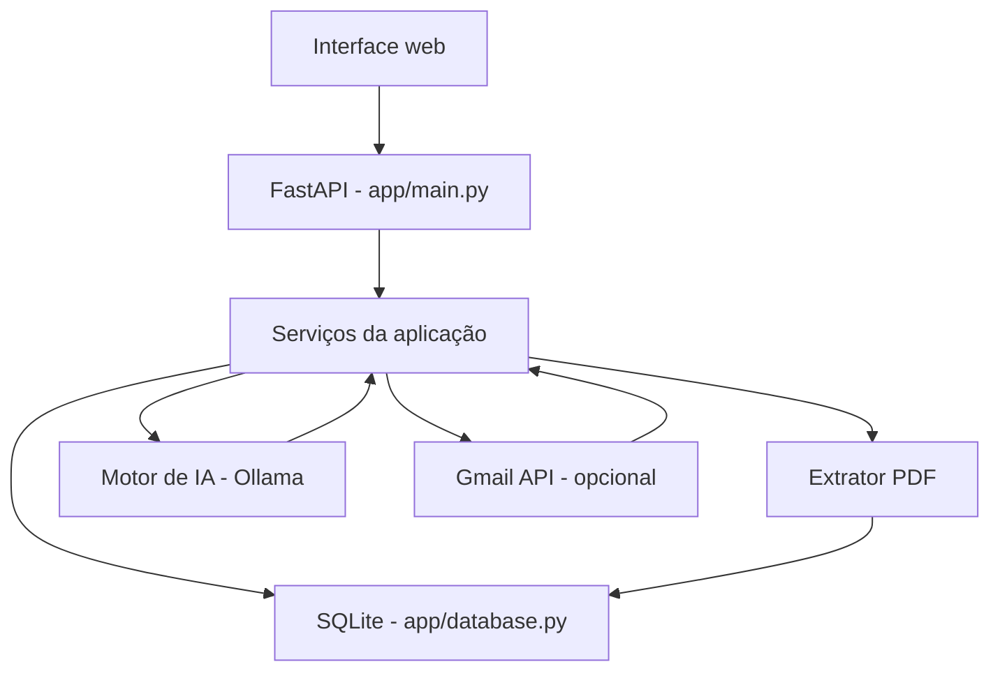

# Visão geral e arquitetura

## 1. Organização em camadas

O Veyn está estruturado como uma aplicação Python com estas partes:

1. **Interface web:** páginas HTML em `app/templates/` e estilos em `app/static/`.
2. **Aplicação/API:** `app/main.py` define a aplicação FastAPI, as páginas e os endpoints JSON.
3. **Serviços de domínio:** módulos separados para autenticação, sincronização, extração de documentos, IA e gestão de casos.
4. **Persistência:** `app/database.py` centraliza conexões, transações, criação do esquema e consultas auxiliares do SQLite.
5. **Integrações opcionais:** Gmail API para leitura de mensagens e Ollama para processamento de linguagem local.

## 2. Fluxo geral de processamento

## 3. Módulos principais

| Arquivo | Responsabilidade |
|---|---|
| `app/main.py` | Inicialização FastAPI, autenticação das requisições, páginas e endpoints. |
| `app/config.py` | Leitura das configurações locais e definição de caminhos e parâmetros. |
| `app/database.py` | Conexões SQLite, transações, esquema, auditoria e métricas. |
| `app/auth.py` | Hash de senha, autenticação e sessões. |
| `app/sync_service.py` | Orquestração da sincronização simulada e da rotina de leitura do Gmail. |
| `app/extractor.py` | Leitura de texto PDF e extração baseada em regras. |
| `app/ai_engine.py` | Chamadas ao Ollama, classificação, síntese e resumo de mensagens. |
| `app/case_manager.py` | Criação, localização e atualização de casos. |
| `app/gmail_service.py` | Autorização OAuth e criação do cliente Gmail API. |
| `app/backup/` | Cópias de módulos antigos; não são os módulos importados pelo ponto de entrada atual. |

## 4. Inicialização

O ponto de entrada ASGI é `app.main:app`. Durante o ciclo de inicialização, a aplicação chama `init_db()` e verifica/cria um usuário administrador inicial. O script `iniciar.bat` inicia o Uvicorn com o endereço de loopback (`127.0.0.1`) e a porta `8000`.

## 5. Componentes de IA

O motor de IA envia requisições HTTP para a API local do Ollama. O código possui dois parâmetros de modelo configuráveis: um para tarefas rápidas e outro para análise de maior qualidade. Se a classificação de e-mail não obtiver resposta da IA, há fallback por palavras-chave. O resumo individual também possui fallback simples.

**Limitação observada:** a função de análise de caso não apresenta um retorno alternativo completo quando a chamada ao Ollama falha ou devolve JSON inválido. Como o gerenciador de casos espera os campos da resposta, uma falha nessa etapa pode interromper o processamento.

## 6. Integração com Gmail

A autenticação é feita por OAuth e o escopo solicitado no código é somente leitura. A rotina `sincronizar_gmail_real()` consulta mensagens que correspondem a uma busca pré-definida e grava metadados básicos no banco.

No estado do código analisado, essa rotina não baixa nem processa anexos e não está conectada ao endpoint de sincronização acionado pelo painel. O endpoint atual chama a sincronização de dados simulados.
